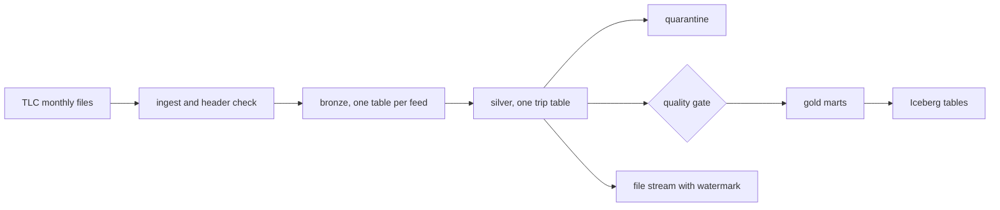

# pyspark-lakehouse-etl-pipeline

[](https://github.com/adwitiyashukla/pyspark-lakehouse-etl-pipeline/actions/workflows/ci.yml)

A PySpark ETL pipeline over the NYC taxi and for-hire trip records. It downloads the monthly gzip files, turns them into Parquet, merges four different trip feeds into one trip table, builds marts, commits them to Iceberg tables, and runs a streaming job with a watermark on the side. I built it to get properly good at Spark, so it also has a tuning lab that runs the same work the slow way and the fast way and records what Spark actually did each time.

The Python package and the CLI are called lakeetl.

## Pipeline



Every stage is a CLI command. The Airflow DAG in `airflow/dags` runs the same commands in order, so the pipeline behaves the same from a terminal and from Airflow.

## Sources

The NYC TLC trip records, read from the DataTalksClub mirror on GitHub releases, plus the 265 row taxi zone lookup.

| feed | what it holds |
|---|---|
| yellow | street hail yellow cabs |
| green | boro taxis outside central Manhattan |
| fhv | for-hire trips from the smaller bases |
| fhvhv | high volume for-hire trips, the app companies |

The mirror covers 2019-01 to 2021-07, which is 210.9 million trips. All the numbers below are for the 2021 window, January to July, which is 35.95 million trips. Changing `start_month` in `config.toml` runs the whole mirror with the same code.

Two things in the source files that the loader has to handle:

- The mirror publishes `fhvhv_tripdata_2021-06.csv.gz`, but the rows inside have the fhv layout. Ingest reads the header of every file and checks it against the layouts it knows before it trusts the file name, so this file is rejected instead of loaded.
- The fhv files renamed three columns between 2019 and 2020 (`dropOff_datetime`, `PUlocationID` and `DOlocationID` became `dropoff_datetime`, `PULocationID` and `DOLocationID`). Each layout is its own schema in `schemas.py` and both land in the same bronze table.

## Layers

- bronze: gzip CSV to Parquet, one table per feed, partitioned by the month of the source file. Schemas are explicit, nothing is inferred. Rows Spark cannot parse are kept with a flag instead of dropped.
- silver: the four feeds mapped onto one trip model, with durations, speeds and zone flags. Trips that break a rule (negative duration, under 30 seconds, over 6 hours, too far, too fast, fare over 2000 dollars) go to a quarantine table with the reason. Exact duplicates are dropped.
- quality gate: 37 checks between silver and gold. Error checks block gold, warnings only get reported. It also checks that the row counts each stage recorded match what is on disk, so a stage that died halfway cannot pass.
- gold: six marts, from an origin destination grain per month and feed up to zone, hour, airport and feed share views.
- Iceberg: the gold marts are committed through PyIceberg on a SQLite catalog. The grain table goes in as two commits so there are two snapshots to time travel between, then gets a schema change.
- streaming: Structured Streaming over a folder of Parquet files, 15 minute windows per pickup zone, a 30 minute watermark and a checkpoint.

One trick in silver: duplicates always share a pickup time, so they always share a pickup month. Silver already repartitions by `pickup_month` for the write, which puts every duplicate pair in the same task, so `dropDuplicates(["pickup_month", "trip_id"])` runs without a second shuffle. The physical plan has one Exchange for the whole layer. The catch is that the write runs one task per month, so the 7 month window ran as 7 big tasks.

## Tuning lab

`lakeetl tune` runs each experiment twice on the same data and records Spark's own stage metrics from its REST API: tasks, bytes read, shuffle bytes, spill and the slowest task. Both versions have to return the same row count or the run fails.

| experiment | rows both sides return | slow side | fast side |
|---|---|---|---|
| gzip CSV against Parquet | 4,666,625 | gzip CSV, 5.9 s | bronze Parquet, 0.8 s |
| schema | 4,666,625 | inferred, 9.7 s, 170.7 MB read | explicit, 1.4 s, 85.3 MB read |
| join to the zone table | 17,277,862 | sort merge, 10.6 s, 53.5 MB shuffled | broadcast, 1.7 s, nothing shuffled |
| skewed join | 11,907,910 | direct, slowest task 11.2 s | salted, slowest task 5.5 s |
| adaptive execution | 6,268 | off, 212 tasks, 14.7 s | on, 13 tasks, 9.1 s |
| partition pruning | 14,462,212 | month from the timestamp, 6.5 s, 291.3 MB read | partition filter, 0.5 s, 0.2 MB read |
| small files | 14,462,212 | 200 files, 37.7 s | 1 file, 2.1 s |

- The gzip result is the reason bronze exists. A gzip file cannot be split, so Spark gives each file exactly one task. The one app company file for January 2021 holds 11.9 million rows and took 249 seconds in bronze on a single task.
- Schema inference reads the files twice, once to guess the types and once for the real work. The bytes read double and the run takes about 7 times longer.
- The zone table has 265 rows, so sending a copy to every task beats shuffling 53.5 MB of trips.
- HV0003 holds 73.1 percent of the January app trips, so a plain join on the license number puts most of the data in one task. Salting spreads that key over 16 buckets and cuts the slowest task from 11.2 s to 5.5 s. On 4 local cores the whole join still took longer, 18.1 s against 16.4 s, because the salted side shuffles 38 percent more data. Adaptive skew join did not split anything here, since the hot partition stayed under Spark's 256 MB default for calling a partition skewed.
- With 200 shuffle partitions on a small aggregation, adaptive execution merged them into 13 tasks and finished 38 percent faster.
- Filtering on the partition column lets Spark skip every other month. Computing the same month from the timestamp makes it open every file.
- The same month written as 200 small files took about 18 times longer to aggregate than one compacted file.

## What the data shows

- In January 2021 the app companies carried 11,907,910 trips, 82.3 percent of all trips in the four feeds that month. Yellow cabs carried 1,351,061, which is 9.3 percent. January is the only month of app company data in the mirror.
- Yellow cab trips doubled between January and July 2021, from 1,351,061 to 2,787,159.
- HV0003, the Uber license, holds 73.1 percent of the January app trips. The same number drives the skewed join above.
- Yellow pickups at JFK outnumber yellow dropoffs at JFK 406,393 to 71,042. A JFK pickup averages 56.40 dollars over 15.53 miles and 35.0 minutes.
- Yellow trips average 25.03 mph at 5 am and 11.56 mph at 3 pm, which is also the busiest hour with 1,079,153 trips.
- Yellow trips picked up in Manhattan tip 18.61 percent of the fare, Queens 13.40 percent, Brooklyn 5.27 percent and the Bronx 2.19 percent. The files only record card tips, so this partly follows how many riders pay by card.
- 85.2 percent of fhv trips have no usable pickup or dropoff zone, 7,121,416 of 8,354,794. This is the one warning the quality gate raises.
- The app company feed is the cleanest by far. Silver rejected 530 of its 11.9 million trips, against 182,263 of the 15.0 million yellow trips. The most common rejection is a trip under 30 seconds (207,291), and 28,339 trips end before they start.

## Running it

You need Python 3.11 or newer and Java 17 or 21 (Spark 3.5 does not start on Java 23). On Windows, Spark also needs `winutils.exe` and `hadoop.dll` for Hadoop 3.3 in a `bin` folder, with `HADOOP_HOME` pointing at the folder above it.

```
python -m venv .venv
.venv\Scripts\activate
pip install -e .[dev]
python -m lakeetl.cli pipeline
```

`pipeline` runs ingest, bronze, silver, gold, the quality gate and Iceberg. The other commands:

```
python -m lakeetl.cli stream-produce
python -m lakeetl.cli stream-run --reset
python -m lakeetl.cli tune
python -m lakeetl.cli cluster-start --workers 2
python -m lakeetl.cli report
```

Every setting lives in `config.toml` and is validated when it loads. `config.ci.toml` is a two month slice for CI. Spark's scratch files go to `data/spark-local` instead of the system temp folder, and each run removes its own folder when it stops.

## Tests

85 pytest tests run against small generated trip files, so they need no network. They cover the config validation, every published header, both fhv layouts, broken and off-month rows, quarantine reasons, duplicates, the marts adding back up to silver, the quality gate blocking, Iceberg snapshots, the streaming watermark and a streaming rerun that reads nothing.

CI has three jobs. lint-and-test runs ruff and pytest on Python 3.11, 3.12 and 3.13. pipeline runs every stage on `config.ci.toml` against the live mirror and checks that a bronze rerun loads nothing. airflow-dag runs the DAG with `airflow dags test`.

## Numbers

Measured with the settings in `config.toml`, four local cores and a 2 GB driver.

| stage | result | time |
|---|---|---|
| ingest | 22 files, 0.68 GB, 1 rejected, 5 not published | 14 s |
| bronze | 35,950,812 rows, 0 corrupt, 646 MB | 567.3 s |
| silver | 35,641,192 kept, 295,828 quarantined, 13,792 duplicates dropped, 1.41 GB | 401.6 s |
| gold | 523,589 rows over 6 marts | 57.0 s |
| quality gate | 37 checks, 0 blocking, 1 warning | 61.3 s |
| Iceberg | 6 tables, grain table in 2 snapshots | 1.4 s |
| streaming | 420,000 events over 7 batches, 247,516 window rows, 13,117 dropped as late | |
| streaming rerun | 0 events read | |
| bronze rerun | 0 partitions built | |
